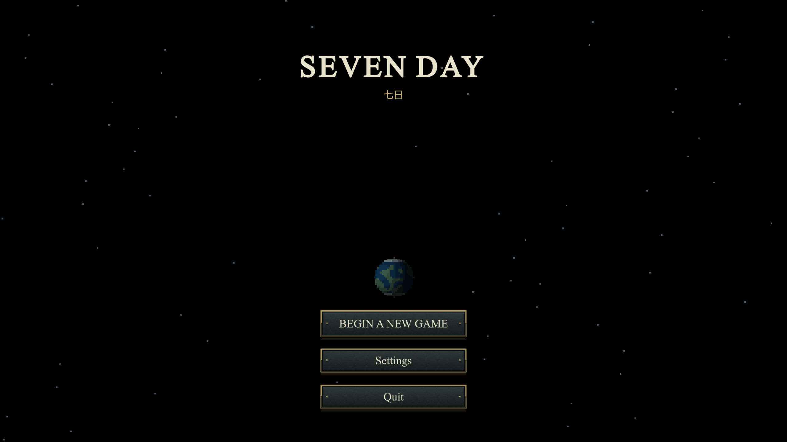
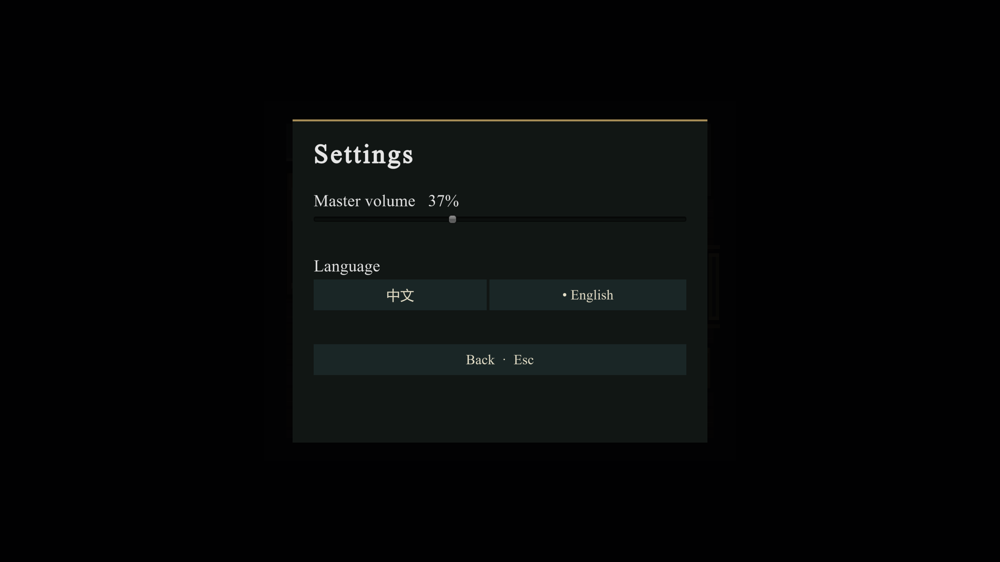
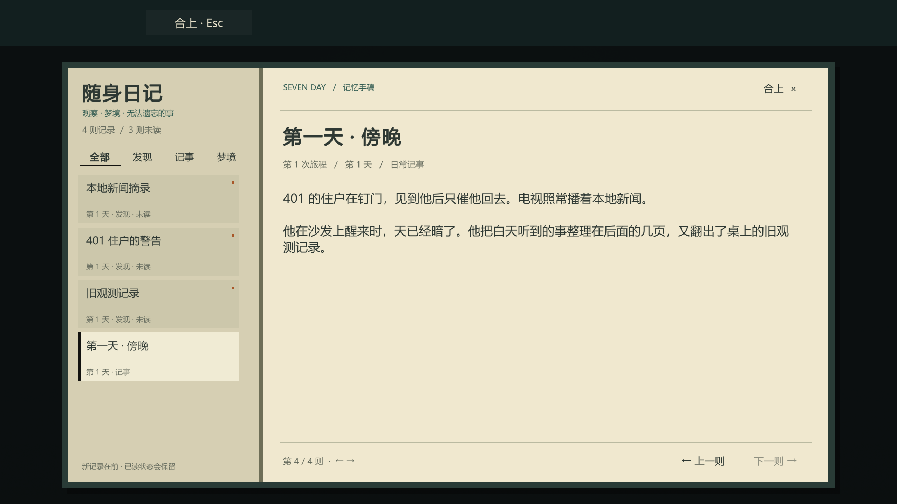
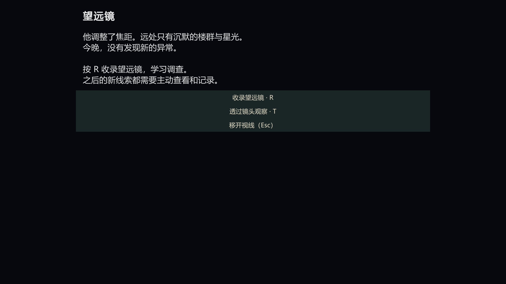

# 2026-10-30 · 第一日新手引导

本轮按最后一段具体描述确定顺序：看新闻 → 在沙发上睡到傍晚 → 到卧室书桌写日记 → 望远镜观察 → 主动记录 → 连线推理。第一夜是普通观测；第二夜的古神目击和序章条件继续保留。

## 玩家流程

1. 梦境与床边醒来：Enter 推进梦境，敲木声和起床动画衔接。此时没有日记、连线提示，也不能提前收集。
2. 出门：401 住户停锤、看过来，主动催来客回去。完成对话后引导回家找吃的。
3. 厨房：打开冰箱切换为实际开门像素贴图，显示内侧搁架与食物。首次开门触发四条普通新闻，新闻没有 R 摘录操作。
4. 看完电视：引导走到客厅沙发，按 E 休息。角色在沙发上睡着，醒来仍是第一天，时段到傍晚。
5. 第一次日记：提示到卧室书桌前，按 E 写日记。写完才出现 J；当天已发生的信息统一整理成初始记录，不把梦境算作线索。
6. 初始记录包含「第一天·傍晚」「旧观测记录」「401 住户的警告」「本地新闻摘录」，按实际事件和稳定 ID 去重。
7. 望远镜：先观察，再学习按 R 收录。此时才解锁调查与 B 连线。
8. 连接「旧观测记录」与「阳台的望远镜」，先留下待证，再确认「天文爱好者」结论。教程结束，之后的线索需要主动调查，床与电视恢复常规时间操作。

## 传单、叙事与设置

- 四楼第一天不再放传单。原纸张、三行字和配色保存在 `Assets/Prefabs/Story/LobbyNoticeFlyer.prefab`，供以后的一楼告示栏使用；本轮没有扩建一楼。
- 第二天 401 门上的纸条仍是邪教线的独立前置，先调查纸条，再敲门。它不是告示栏传单。
- 主角叙述、观察记录与推论统一第三人称。人物直接引语保留说话者自然的人称。
- 游戏英文名统一为 `SEVEN DAY`。英文界面使用 Times New Roman，后备为 Georgia / Liberation Serif；中文保留可读的中文字体。通过系统字体加载，没有打包再分发字体文件。
- 主菜单与暂停页提供「设置」，包含总音量和中英切换；Esc 返回原菜单。音量与语言属于玩家偏好，开始新旅程不清除它们。

## 状态和修复

`morningStage`：0 初始梦境、1 起床、2 邻居、3 厨房、4 新闻、5 沙发、6 书桌、7 望远镜、8 主动记录、9 连线、10 教程完成。

冰箱的「曾经打开」「当前门是否打开」与新闻的「已开始」「页数」「已完成」分别保存。反复开关冰箱只换贴图，不把教程设回新闻阶段；新闻中断后接着未完页显示。完成标记与沙发阶段一同保存，兼容旧版本已完成新闻但阶段未更新的数据。

起床、沙发小睡和写作期间占用输入；结束或重置后恢复角色显示和物理状态。写日记采用一次性批量加入，重复接近书桌不重复发放初始条目。教程结束后再观察望远镜不会重播教学提示。

存档升级为版本 2。版本 1 已有日记的记录保留，并保留日记和调查访问权；新旅程重置教程、新闻和冰箱状态。第一次完整体验请从新游戏开始。

## 验证结果

- Unity 6000.6.7f1 独立工程编译通过。
- 独立运行的 63 项流程逻辑检查通过：设置读写、字体选择、剧情顺序、新闻去重与中断恢复、初始信息去重、调查与推理、旧存档迁移、完整重置。
- 七日边界、睡眠、死亡、衰老、知识奖励、结局和存档回归通过。
- 邪教线 24 项独立检查通过：首日对话门槛、次日纸条与敲门、赠物手动拾取、背包去重与保存、电视下方通行。批量运行出现 UnityEditor.Search.SearchDatabase 索引异常，未计为游戏运行时异常；实际画面仍待解锁复核。
- 打开冰箱的贴图与预留传单 Prefab 已导入，柜体锚点与闭合贴图对齐。
- 解锁后在原工程运行完整新手教程与设置验收，62 项交互检查通过。修复设置面板接收 IMGUI Esc 事件的返回路径后，重新运行仍为 62 项通过。测试备份并还原原存档、语言和音量。
- 手动点击语言按钮、拖动音量 100% → 50% → 100%、切回中文与 Esc 返回主菜单均通过。已核对中英文菜单、新闻、首次日记和调查教学的渲染画面。
- 批量模式不能可靠处理编辑器模拟按键，先前失败尝试未计为通过；本轮交互结果来自原工程的编辑器运行。
- 可复跑 Prototype → Test full first-day onboarding and settings。报告和关键截图保存在 `docs/validation/onboarding/`。

### 关键画面

